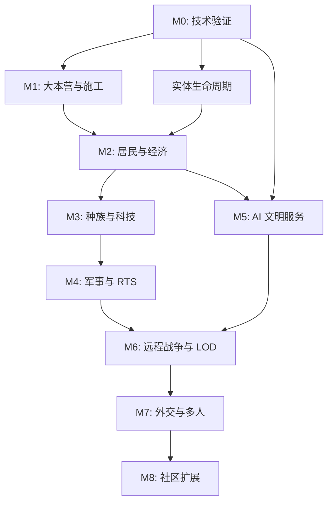

# 开发路线图与依赖关系

## 1. 里程碑总览

| 里程碑 | 目标 | 主要交付 | 退出条件 |
|---|---|---|---|
| M0 | 技术验证 | SavedData、Faction/Citizen、实体生命周期、远程调度、最小蓝图 | 关键持久化和 LOD 测试通过 |
| M1 | 基地建造 | 大本营、蓝图、材料预留、施工状态机 | 能从空地完成第一座建筑 |
| M2 | 人口经济 | 居民、岗位、资源点、仓储和生产 | 基地能自我维持基本资源循环 |
| M3 | 文明差异 | 种族、基础科技、建筑外观 | 熊/狼/龙裔配置可独立加载 |
| M4 | 军事 RTS | 训练、编队、命令、实时战斗、防御 | 玩家完成一次基地攻防 |
| M5 | AI 文明 | AI 经济、建造、训练、战略人格 | AI 不作弊也能独立成长 |
| M6 | 世界模拟 | LOD 实体化、远程战争、状态对账 | 区块不加载时文明仍合理演化 |
| M7 | 世界外交/多人 | 贸易、外交、玩家势力、服务器优化 | 多人长时间压力测试通过 |
| M8 | 内容扩展 | 自定义蓝图、更多单位、特殊龙族能力、创作者接口 | 扩展包接口稳定 |

## 2. 推荐实施顺序

M0 必须同时验证持久化、身份和远程模拟，不能把远程模拟拖到 M6 才设计。M1 与 M2 可以在 M0 通过后并行编写部分静态内容，但任何依赖真实实体生命周期的功能必须等待 CitizenLifecycleService 稳定。

## 3. M0 详细任务分解

| ID | 任务 | 前置 | 输出 | 验收 |
|---|---|---|---|---|
| M0-001 | 初始化 Forge MDK 工程 | 无 | 可启动工程 | build/client/server 均通过 |
| M0-002 | 注册 mod、基础日志、配置 | 001 | mod skeleton | Mods 列表正确 |
| M0-003 | SavedData registry | 002 | EmpiresWorldData | 重启后数据不丢 |
| M0-004 | FactionRecord/Repository | 003 | 领域模型 | 创建/查找/更新测试通过 |
| M0-005 | CitizenRecord | 004 | 逻辑居民 | ID 稳定保存 |
| M0-006 | NPC Entity | 005 | 最小实体 | 能生成/加载/移除 |
| M0-007 | LifecycleService | 006 | 实体化/休眠 | 无重复实体 |
| M0-008 | SimulationScheduler | 003 | 纯数据调度 | 未加载区域数据变化 |
| M0-009 | Blueprint/BuildingRecord | 003 | 蓝图逻辑 | 记录保存恢复 |
| M0-010 | Block placement adapter | 009 | 小模板放置 | 只修改已加载 chunk |
| M0-011 | Debug commands | 003-010 | 调试工具 | 可查询/验证状态 |
| M0-012 | M0 integration test | 001-011 | 验收报告 | M0 checklist 全通过 |

## 4. M1 任务分解

- M1-001 HQ 物品/方块/蓝图注册。
- M1-002 Capital uniqueness service。
- M1-003 放置预检查（地形、边界、重叠、势力权限）。
- M1-004 ResourceLedger 与原子预留。
- M1-005 ConstructionProject 状态机。
- M1-006 Builder Job。
- M1-007 分批方块施工。
- M1-008 保存/恢复/取消/损坏。
- M1-009 基地管理 UI 最小版。
- M1-010 M1 集成测试。

## 5. M2 任务分解

- M2-001 住宅与住房容量。
- M2-002 Citizen profession/workplace assignment。
- M2-003 Job scheduler / reservation / timeout。
- M2-004 ResourceNode registration。
- M2-005 Lumberjack gathering loop。
- M2-006 Farmer production loop。
- M2-007 Shared inventory / storage capacity。
- M2-008 Food consumption and needs。
- M2-009 Citizen UI / building UI snapshots。
- M2-010 M2 经济稳定性测试。

## 6. 后续里程碑交付内容

### M3
Species registry、traits、modifiers、三种族模型/材质、种族建筑配置、基础科技树、科技效果接口。

### M4
UnitRecord、ArmyGroup、Command Gateway、选择和编队 UI、移动/攻击/防守/撤退命令、基础兵种、箭塔和城墙、战斗回归测试。

### M5
AI Personality、Utility Scoring、Strategic Planner、AI Command Producer、AI building plan、AI economy、AI military training、AI test scenarios。

### M6
LODCoordinator、area demand、spawn lease、hibernate reconciliation、abstract battle snapshots、real-time battle handoff、远距离一致性压力测试。

### M7
DiplomacyRelation、treaties、trade routes、player faction permissions、server authority hardening、多人负载测试。

### M8
玩家蓝图导入导出、内容包加载、更多种族、飞行单位实验、数据迁移工具、创作者文档。

## 7. 发布门槛

- 每个里程碑全部 P0 验收通过。
- 新旧存档迁移测试通过。
- Dedicated Server 启动和运行通过。
- 无客户端类在专用服务器加载。
- 没有无限 Chunk Ticket。
- 已知性能限制和兼容性在 README 公开。
- 提供备份提示、版本号和变更日志。

## 8. 不允许的开发捷径

- 不得先做 UI 假数据，再把假数据当成系统完成。
- 不得 AI 直接改世界方块绕过 BuildingService。
- 不得让 NPC Entity 成为居民身份唯一来源。
- 不得让 AI 凭空获得玩家没有的资源，除非规则明确允许事件奖励。
- 不得在多个子系统里复制不同版本的资源扣除逻辑。
- 不得为演示效果强制加载整个 AI 基地。
